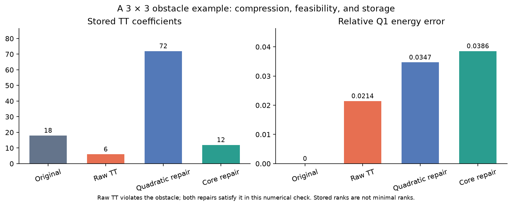

# tt-obstacle

**Feasibility-preserving tensor-train approximation for discrete obstacle problems.**

`tt-obstacle` is a NumPy research package for studying what happens when TT
compression violates a nodal inequality, and how positive envelopes can repair
it. It combines core-based tensor operations, consistent Q1 finite-element
energies, reproducible examples, and mathematical derivations.

**Version 0.1.0 is experimental research software.** It provides approximation
and repair tools for a given feasible tensor. The included obstacle solver is
a small dense reference, limited to 16 unknowns by default. A scalable
multidimensional PDE solver is an open development task.

[Русское описание](README.ru.md) · [Getting started](docs/getting_started.md) ·
[Mathematics](docs/mathematics.md) · [API](docs/api.md) ·
[Limitations](docs/limitations.md)

## The idea

Suppose a tensor `U` satisfies the nodal obstacle `U >= psi`. An ordinary TT
approximation `V` may violate that constraint. For `R = U - V`, construct an
envelope `E(R) >= abs(R)` and return

$$
W = V + E(R) \ge U \ge \psi.
$$

The package implements a quadratic TT envelope and rank-one alternatives.
Their domination properties hold in exact arithmetic under the documented
assumptions. Uniform energy estimates require more structure than a small TT
rank. Floating-point diagnostics are supplied; interval certification is not.

## Install and run

Python 3.10+ and NumPy 1.24+ are required. From the extracted repository:

```bash
python -m venv .venv
source .venv/bin/activate
python -m pip install .
python examples/compression_and_repair.py
python -m unittest discover -s tests -v
```

On Windows PowerShell, activate with `.venv\Scripts\Activate.ps1`.
Install `".[plots]"` to reproduce the figure below. These commands install
the local source; availability on PyPI is not assumed.

```python
import numpy as np
from tt_obstacle import Q1Operator, TensorTrain, feasible_compress

op = Q1Operator.uniform((3, 3, 3))
U = op.ground_tensor.add(
    TensorTrain.rank_one([np.ones(3)] * 3).scaled(0.01)
)
# U is feasible for the zero obstacle by construction.
report = feasible_compress(U, op, rtol=1e-6, max_rank=1, method="core")
W = report.tensor
print("stored coefficients:", report.original_storage, report.result_storage)
print("computed energy-error bound:", report.error_bound)
print("mass rounding target met:", report.rounding_tolerance_met)
```

`max_rank` caps the initial rounded candidate, not the repaired output.
`rtol` targets mass-norm rounding error, not the final energy error. A binding
rank cap can prevent the requested tolerance from being reached.

## A reproducible obstacle example

The example solves a 3 × 3 interior-node Q1 obstacle problem with mixed
contact, compresses its solution, and compares two repairs. The recorded run
gave:

| Representation | Stored TT coefficients | Minimum nodal slack | Relative energy error |
| --- | ---: | ---: | ---: |
| Original reference | 18 | approximately 0 | 0 |
| Raw rank-one TT | 6 | −0.01096 | 0.02144 |
| Quadratic repair | 72 | 0.002410 | 0.03469 |
| Core rank-one repair | 12 | 0.0008776 | 0.03856 |



These are stored core sizes, not minimal ranks. Repair is not guaranteed to
reduce storage. The deliberately tight initial rank cap misses the requested
mass tolerance; the output reports this explicitly. See the complete
[recorded diagnostics](results/compression.json).

The [dimension sweep](results/dimension_sweep.json) uses constructed inputs in
4, 8, and 16 coordinates without assembling full tensors. It also exposes the
cost of a loose envelope: in its 16-dimensional case, core rank-one repair has
relative energy error about 5.90, versus 0.0233 for quadratic repair. This is an
illustration of the tradeoff, not a claim of general solver performance.

## Included in this version

- TT arithmetic, QR/SVD rounding, symmetric Hadamard squares, and local mode maps.
- Consistent P1/Q1 assembly, mass and energy contractions, and ground-state data.
- Quadratic and rank-one envelope repairs, with measured storage and error bounds.
- Interaction-degree, coordinate, and local spectral projectors.
- A small exhaustive active-set reference and primal–dual error estimates.
- Unit tests, three examples, a dimension sweep, and a GitHub Actions test workflow.
- Research notes and independent numerical audits, including counterexamples.

```text
src/tt_obstacle/   Python package
tests/            Unit tests with dense references and structural invariants
examples/         Small obstacle problem, core-only tradeoff, failure cases
experiments/      Reproducible dimension sweep
results/          Small saved outputs and a generated figure
docs/             Setup, mathematics, API, limitations, publishing
theory/           Derivations and internal reviews, primarily in Russian
research/audits/  Independent numerical checks of the research notes
```

The [mathematical overview](docs/mathematics.md) separates unconditional
domination from conditional energy guarantees. The [research guide](theory/README.md)
links detailed proofs, related work, and obstructions. Scientific priority has
not been established; the notes are working derivations, not a peer-reviewed
paper.

See [reproduction commands](docs/getting_started.md),
[contribution guidelines](CONTRIBUTING.md), and
[manual publishing instructions](docs/publishing.md).
The project uses the [MIT license](LICENSE); software citation metadata is in
[CITATION.cff](CITATION.cff).
